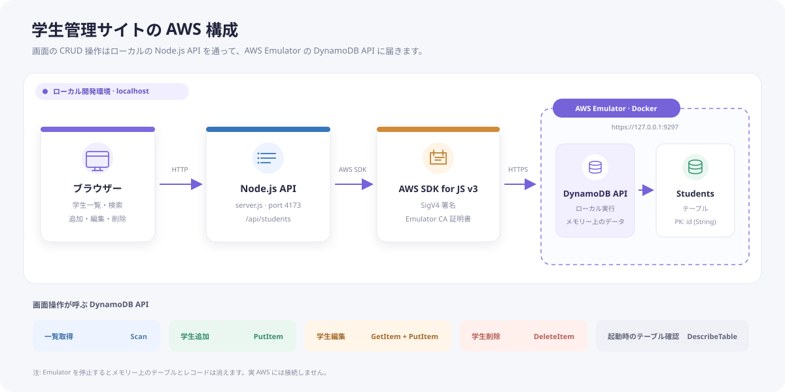

# AWS サービス構成ガイド

## 全体像

このサイトが AWS API として使うのは **Amazon DynamoDB** です。ブラウザーからのリクエストを Node.js サーバーが受け、AWS SDK for JavaScript v3 を通して、ローカルで起動した AWS Emulator の DynamoDB API に送ります。

## 使っているもの

| 名前 | 役割 | このプロジェクトでの使い方 |
| --- | --- | --- |
| **Amazon DynamoDB** | AWS の NoSQL データベース | `Students` テーブルに学生情報を保存・検索します。Emulator 内のメモリー上で動作します。 |
| **AWS Emulator** | AWS API のローカルエミュレーター | DynamoDB API の送信先です。Windows の Docker Desktop 上で動かし、`https://127.0.0.1:9297` で待ち受けます。 |
| **AWS SDK for JavaScript v3** | Node.js から AWS API を呼び出す SDK | SigV4 署名を付けて DynamoDB リクエストを送ります。Emulator の CA 証明書を Node.js に読み込ませています。 |
| **Node.js** | Web アプリのバックエンド実行環境 | 学生管理画面の配信と `/api/students` API を担当します。`127.0.0.1:4173` で待ち受けます。 |
| **Docker Desktop** | コンテナー実行環境 | Windows 上で AWS Emulator を動かします。AWS サービスではありません。 |

## 画面操作と DynamoDB API

| 画面・サーバー操作 | DynamoDB API | 内容 |
| --- | --- | --- |
| 起動時のテーブル確認、接続表示 `GET /api/health` | `DescribeTable` | `Students` テーブルの状態を確認します。 |
| 一覧表示 `GET /api/students` | `Scan` | テーブル内の学生を一覧で読み込みます。 |
| 学生追加 `POST /api/students` | `PutItem` | 学籍番号が重複していない条件で新しい項目を登録します。 |
| 学生編集 `PUT /api/students/:id` | `GetItem` → `PutItem` | 既存の出席率などを読み、編集した基本情報を保存します。 |
| 学生削除 `DELETE /api/students/:id` | `DeleteItem` | 指定した学籍番号の項目を削除します。 |
| 初回テーブル作成 | `CreateTable` | `id`（文字列）をパーティションキーとする `Students` テーブルを作ります。新規テーブル作成時にデモデータ8件を登録します。 |

## データモデル

テーブル名は `Students`、パーティションキーは `id`（学籍番号、文字列）です。学生項目には `name`、`className`、`email`、`status`、`attendance`、表示用の `color` / `ink` を保存します。

## AWS Emulator で試すときのポイント

- これは実 AWS ではなく、`127.0.0.1` の AWS Emulator に送るローカル動作です。AWS アカウントや実 AWS リソースは使いません。
- Emulator のリソースはメモリー上にあるため、コンテナーを停止するとテーブルとデータが消えます。再起動時はテーブルを作り直し、サンプルを再登録します。
- `start.ps1` は Emulator が発行した認証ファイルと `ca.pem` を読み込みます。また、実 AWS の認証情報を環境変数から外し、送信先を Emulator に固定します。
- Emulator の匿名テレメトリーは、このプロジェクトの起動コマンドでオフにしています。
- このアプリは API Gateway、Lambda、Cognito、S3 を使っていません。必要な AWS API は DynamoDB のみです。

## 関連ファイル

- `Dockerfile` — AWS Emulator のコンテナーイメージ
- `start.ps1` — SDK の接続先、認証情報、証明書の設定
- `server.js` — AWS SDK と DynamoDB の操作
- `package.json` — AWS SDK v3 の依存関係
- `README.md` — 起動と動作確認の手順
